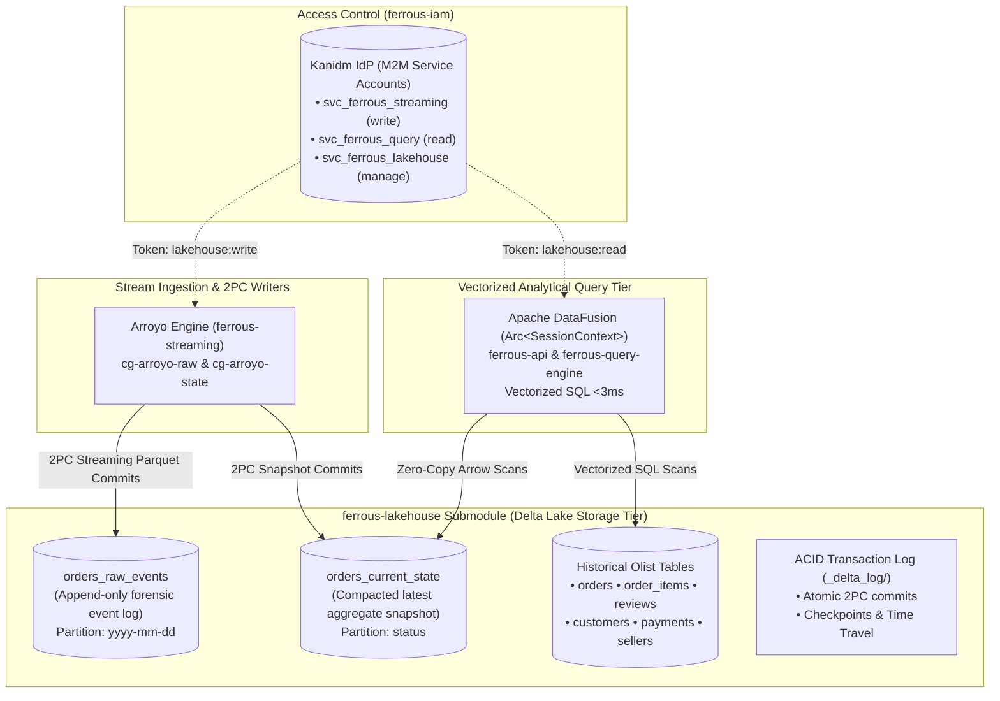

# ferrous-lakehouse

[← Back to FerrousCX Root Architecture](https://github.com/reidlai/ferrouscx-bmad)

[](https://github.com/reidlai/ferrouscx-bmad)
[-orange.svg)](https://delta.io/)
[](.github/workflows/devsecops-infra-ci.yml)
[](.pre-commit-config.yaml)

**`ferrous-lakehouse`** is the dedicated Open Lakehouse storage and schema catalog submodule for the **FerrousCX** enterprise platform. Built on the **Delta Lake (`delta-rs` / `delta-lake-rs`)** open table format, `ferrous-lakehouse` provides ACID transactional guarantees, versioned audit histories (`_delta_log/`), time-travel capabilities, and zero-copy Apache Arrow vectorized scans across all streaming and historical dataset partitions.

---

## 🏛️ Architecture & Role in FerrousCX

`ferrous-lakehouse` separates storage governance from stream processing and query execution:



---

## 📊 Table Catalog & Schemas

| Table Name | Format | Writer | Reader | Description |
| :--- | :--- | :--- | :--- | :--- |
| **`orders_raw_events`** | Delta Lake (Parquet) | Arroyo (`cg-arroyo-raw`) | Audit & Forensics | Append-only event store capturing inbound mutation commands and Iggy payloads. |
| **`orders_current_state`** | Delta Lake (Parquet) | Arroyo (`cg-arroyo-state`) | DataFusion (<3ms) | Live materialized snapshot of active orders, current statuses, and courtesy credit totals. |
| **`llm_benchmarks`** | Delta Lake (Parquet) | `ferrous-agent` (In-process harness) | DataFusion & Svelte Screen 5 | Native in-process LLM benchmark evaluations (TTFT, token/s, model latencies, cost, timestamp) governed under AD-22. |
| **`olist_orders`** | Delta Lake (Parquet) | Batch Replayer / Ingestion | DataFusion | 100k Brazilian e-commerce orders for order investigation and delay radars. |
| **`olist_reviews`** | Delta Lake (Parquet) | Batch Replayer / Ingestion | DataFusion / Qdrant | Customer review texts, timestamps, and satisfaction scores. |
| **`olist_items_payments`** | Delta Lake (Parquet) | Batch Replayer / Ingestion | DataFusion | Freight values, payment installments, and product categories. |

---

## 📁 Repository Structure

```text
ferrous-lakehouse/
├── .github/workflows/
│   └── devsecops-infra-ci.yml   # Tier 2 DevSecOps CI (hadolint, trivy, schema lint)
├── .pre-commit-config.yaml      # Pre-commit hooks (sqlfluff, gitleaks)
├── schemas/                     # Delta Lake Table Schemas & Arrow DDL
│   ├── streaming/               # Streaming runtime tables
│   │   ├── orders_raw_events.sql
│   │   └── orders_current_state.sql
│   ├── benchmarks/              # LLM evaluation runtime tables (AD-22)
│   │   └── llm_benchmarks.sql
│   └── historical/              # Historical Olist benchmark tables
│       ├── olist_orders.sql
│       ├── olist_order_items.sql
│       ├── olist_reviews.sql
│       └── olist_customers.sql
├── config/                      # Delta Lake storage & retention configurations
│   ├── storage.toml             # Storage paths (local /data/delta or MinIO S3)
│   └── retention.toml           # VACUUM (7-day retention) and OPTIMIZE schedules
├── scripts/
│   ├── init-tables.sh           # Initializes Delta Lake directories and _delta_log
│   └── optimize-vacuum.sh       # Runs bin-packing compaction and log cleanup
├── Dockerfile                   # Lightweight maintenance container (maintenance runner)
└── README.md                    # Submodule specification & data dictionary
```

---

## 🛡️ DevSecOps & Quality Assurance (Tier 2 Infrastructure)

- **SQL Schema Linting:** Validated via `sqlfluff` in pre-commit hooks.
- **Container Hardening:** Compaction and maintenance runner builds from minimal distroless base images, verified with `trivy` (zero HIGH/CRITICAL CVEs).
- **Service Account Access:** Access is authenticated through Kanidm M2M Service Accounts (`svc_ferrous_lakehouse`, `svc_ferrous_streaming`, `svc_ferrous_query`).
