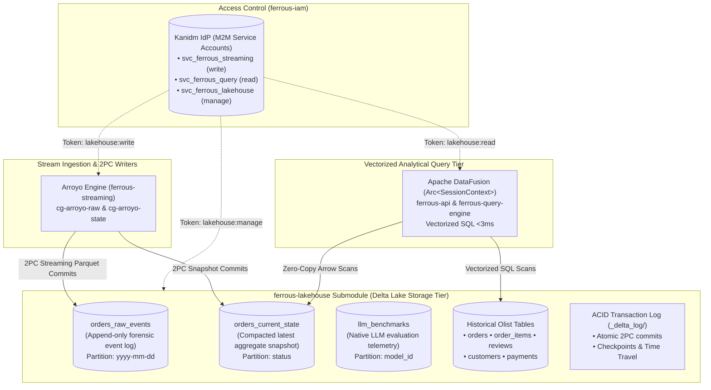

# ferrous-lakehouse

[← Back to FerrousCX Root Architecture](https://github.com/reidlai/ferrouscx-bmad)

[](https://github.com/reidlai/ferrouscx-bmad)
[-orange.svg)](https://delta.io/)
[](.github/workflows/devsecops-infra-ci.yml)
[](.pre-commit-config.yaml)

**`ferrous-lakehouse`** is the dedicated Open Lakehouse storage and schema catalog submodule for the **FerrousCX** enterprise platform. Built on the **Delta Lake (`delta-rs` / `delta-lake-rs`)** open table format, `ferrous-lakehouse` provides ACID transactional guarantees, versioned audit histories (`_delta_log/`), time-travel capabilities, and zero-copy Apache Arrow vectorized scans across all streaming and historical dataset partitions.

---

## 🏛️ Architecture & Role in FerrousCX

`ferrous-lakehouse` separates storage governance from stream processing and query execution:



---

## 📊 Table Catalog & Data Dictionary

| Table Name | Format | Partition Strategy | Primary Key / Index | Description |
| :--- | :--- | :--- | :--- | :--- |
| **`orders_raw_events`** | Delta Lake (Parquet) | `event_timestamp` | `payload_id` (UUIDv7) | Append-only event store capturing inbound mutation commands and Iggy payloads. |
| **`orders_current_state`** | Delta Lake (Parquet) | `status` | `order_id` (String PK) | Live materialized snapshot of active orders, current statuses, and courtesy credit totals. |
| **`llm_benchmarks`** | Delta Lake (Parquet) | `model_id` | `run_id` (UUIDv7) | Native in-process LLM benchmark evaluations (TTFT, token/s, model latencies, cost, timestamp) governed under AD-22. |
| **`olist_orders`** | Delta Lake (Parquet) | `order_status` | `order_id` | 100k Brazilian e-commerce orders for order investigation and delay radars. |
| **`olist_order_items`** | Delta Lake (Parquet) | Unpartitioned | `order_id`, `order_item_id` | Line item breakdown, prices, seller IDs, and shipping limit dates. |
| **`olist_reviews`** | Delta Lake (Parquet) | Unpartitioned | `review_id` | Customer review scores, review titles, and satisfaction comments. |
| **`olist_customers`** | Delta Lake (Parquet) | Unpartitioned | `customer_id` | Customer geographic prefixes and state locations (direct PII purged). |
| **`olist_payments`** | Delta Lake (Parquet) | Unpartitioned | `order_id`, `payment_sequential` | Payment methods, installments, and payment values. |

---

## 🔒 DevSecOps Secret Zero & Environment Configuration

In strict adherence to the **DevSecOps Secret Zero Policy**, no plaintext credentials or bearer tokens are stored in Git. All storage maintenance operations (`optimize`, `vacuum`) enforce authentication with `svc_ferrous_lakehouse` service account credentials (FR-23, AD-16).

### Step 1: Initialize `.env` from Masked Blueprint

#### Windows (PowerShell)
```powershell
Copy-Item .env.example .env
```

#### Linux / macOS (Bash)
```bash
cp .env.example .env
```

---

### Step 2: Configure `LAKEHOUSE_SERVICE_TOKEN`

Choose one of the two operational methods below:

#### Option A: Automated Token Generation from `ferrous-iam` (Recommended)
You can generate and extract an authentic M2M token for `svc_ferrous_lakehouse` directly using the helper script in `ferrous-iam`:

- **Windows (PowerShell)**:
  ```powershell
  ..\ferrous-iam\scripts\get-service-token.ps1 -Account svc_ferrous_lakehouse
  ```
- **Linux / macOS (Bash)**:
  ```bash
  ../ferrous-iam/scripts/get-service-token.sh svc_ferrous_lakehouse
  ```

Copy the generated output directly into your `ferrous-lakehouse/.env`:
```env
LAKEHOUSE_SERVICE_ACCOUNT=svc_ferrous_lakehouse
LAKEHOUSE_SERVICE_TOKEN=ferrous_jwt_m2m_svc_ferrous_lakehouse_...
```

#### Option B: Standalone Local Development (Offline Mode)
If you are developing or testing `ferrous-lakehouse` in isolation without running the `ferrous-iam` container stack:

1. Open `ferrous-lakehouse/.env`.
2. Set `LAKEHOUSE_SERVICE_TOKEN` to any local development token string ($\ge 8$ characters, not containing `<REPLACE_...`):
   ```env
   LAKEHOUSE_SERVICE_ACCOUNT=svc_ferrous_lakehouse
   LAKEHOUSE_SERVICE_TOKEN=lakehouse_dev_token_2026
   ```
3. Storage maintenance scripts and unit tests will validate this developer token and execute compaction and pruning routines locally.

> [!NOTE]
> **Why is there no admin sidebar in the Kanidm Web UI?**
> The Kanidm Web UI (`https://localhost:8443/ui/apps`) is intentionally designed as an end-user self-service portal (for user profile management, WebAuthn security keys, and linked OAuth apps). In Kanidm, administrative operations (such as service accounts, groups, and API tokens) are strictly **CLI- and automation-driven** (`kanidm` CLI / scripts). Use the `get-service-token` helper scripts above to issue service tokens.

---

## ⚡ Quickstart: Local Verification (<3 Minutes)

Run the automated quickstart verification suite on your operating system:

### Windows (PowerShell)
```powershell
# Execute 1-command verification suite
.\scripts\quickstart.ps1
```

### Linux / macOS (Bash)
```bash
# Make executable and run
chmod +x ./scripts/*.sh
./scripts/quickstart.sh
```

### Individual Step Commands

#### Step 1: Validate Schemas and Audit for PII (NFR-8)
- **PowerShell**: `.\scripts\validate-schemas.ps1`
- **Bash**: `./scripts/validate-schemas.sh`

#### Step 2: Initialize Delta Lake Storage & ACID Transaction Logs (AD-17)
- **PowerShell**: `.\scripts\init-tables.ps1`
- **Bash**: `./scripts/init-tables.sh`

#### Step 3: Run Authenticated Compaction (OPTIMIZE)
- **PowerShell**: `.\scripts\optimize.ps1 -Table orders_current_state -TargetMB 128`
- **Bash**: `./scripts/optimize.sh orders_current_state 128`

#### Step 4: Run Retention Pruning (VACUUM)
- **PowerShell**: `.\scripts\vacuum.ps1 -Table orders_current_state -RetentionHours 168`
- **Bash**: `./scripts/vacuum.sh orders_current_state 168`

---

## 📁 Repository Structure

```text
ferrous-lakehouse/
├── .github/workflows/
│   └── devsecops-infra-ci.yml   # Tier 2 DevSecOps CI (hadolint, trivy, schema tests)
├── .pre-commit-config.yaml      # Shift-left hooks (gitleaks, schema audit, yaml/toml)
├── .env.example                 # Masked template for Secret Zero environment variables
├── schemas/                     # Delta Lake Table Schemas & Arrow DDL
│   ├── streaming/               # Streaming runtime tables
│   │   ├── orders_raw_events.sql / .arrow.json
│   │   └── orders_current_state.sql / .arrow.json
│   ├── benchmarks/              # LLM evaluation runtime tables (AD-22)
│   │   └── llm_benchmarks.sql / .arrow.json
│   └── historical/              # Historical Olist benchmark tables
│       ├── olist_orders.sql
│       ├── olist_order_items.sql
│       ├── olist_reviews.sql
│       ├── olist_customers.sql
│       └── olist_payments.sql
├── config/                      # Delta Lake storage & retention configurations
│   ├── storage.toml             # Storage paths (local /data/delta or MinIO S3)
│   └── retention.toml           # VACUUM (7-day retention) and OPTIMIZE schedules
├── scripts/
│   ├── quickstart.sh / .ps1     # 1-command verification suite (<3m)
│   ├── validate-schemas.py      # Schema syntax and PII audit runner
│   ├── init_tables.py           # Delta Lake ACID log and directory initializer
│   ├── optimize.py              # Authenticated compaction (OPTIMIZE)
│   └── vacuum.py                # Authenticated retention pruning (VACUUM)
├── tests/                       # Unit test suite for storage and maintenance
│   ├── test_storage_init.py
│   └── test_maintenance.py
├── Dockerfile                   # Hardened storage initializer & maintenance container
└── README.md                    # Submodule specification & data dictionary
```
